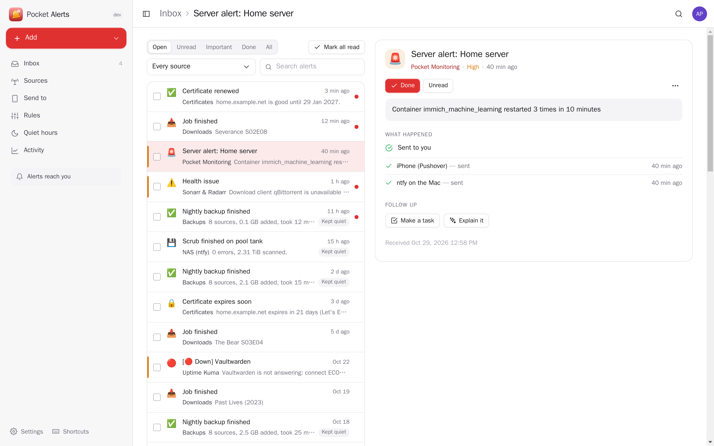
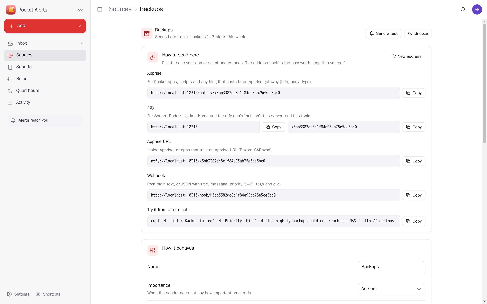
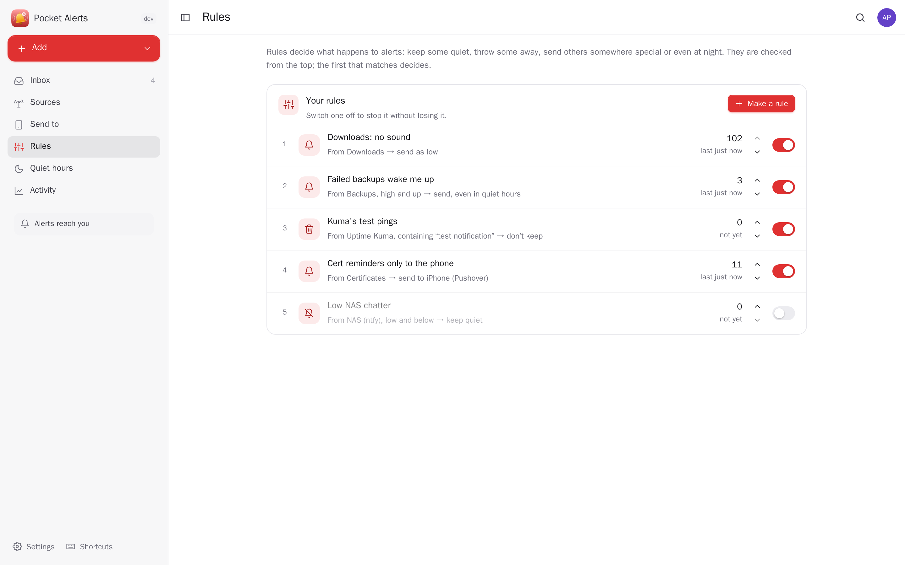
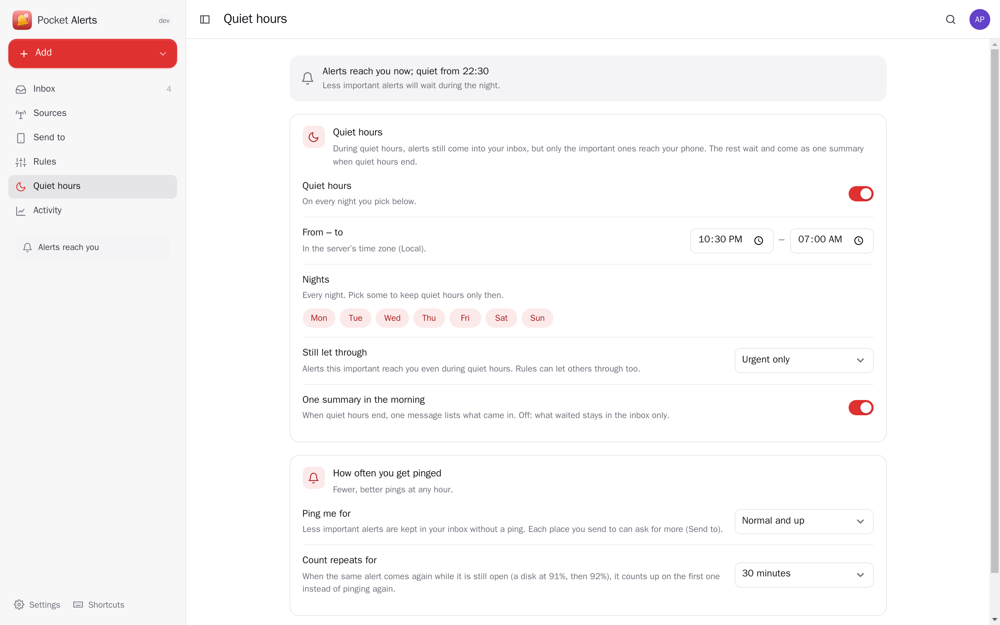
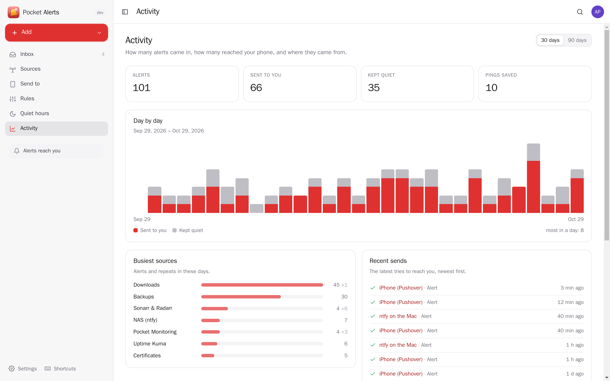
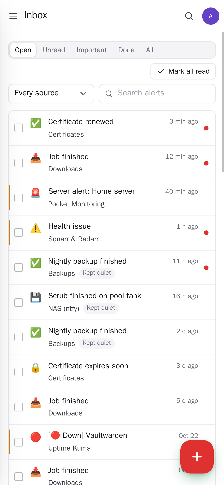
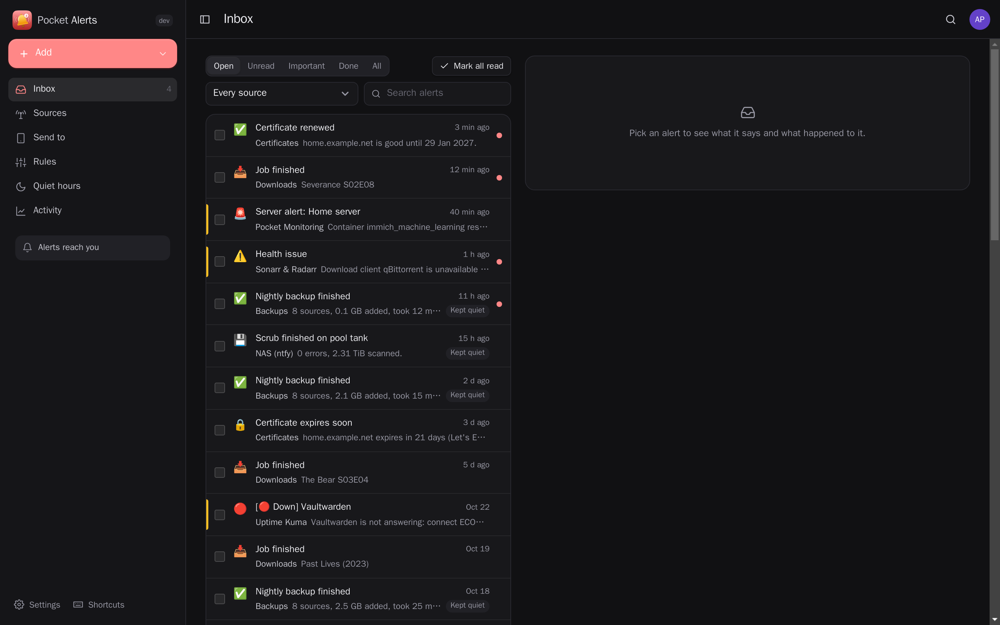

<p align="center"></p>
<h1 align="center">Pocket Alerts</h1>
<p align="center">One inbox for every alert your server, scripts and apps send — and only what matters on your phone. It takes alerts the way Apprise, ntfy and webhooks already send them, counts repeats instead of pinging again, follows your rules, quiet hours and snoozes, and passes the rest on to Pushover, ntfy, Apprise or a webhook.<br>One Go binary, one SQLite file, one volume. Part of the Pocket apps; works on its own too.</p>
<p align="center">
  <a href="https://github.com/abjelosevic88/pocket-homelab-alerts/actions"></a>
  <a href="https://github.com/abjelosevic88/pocket-homelab-alerts/pkgs/container/pocket-homelab-alerts"></a>
  <a href="LICENSE"></a>
</p>

---

<p align="center"></p>

<table>
  <tr>
    <td width="50%"></td>
    <td width="50%"></td>
  </tr>
  <tr>
    <td align="center"><sub>A source: one secret address, in the shapes Apprise, ntfy and webhooks use.</sub></td>
    <td align="center"><sub>Rules: keep some alerts quiet, drop test pings, send failures even at night.</sub></td>
  </tr>
  <tr>
    <td width="50%"></td>
    <td width="50%"></td>
  </tr>
  <tr>
    <td align="center"><sub>Quiet hours: what can wait comes as one summary when they end.</sub></td>
    <td align="center"><sub>Activity: how many alerts, how many reached you, and who sends the most.</sub></td>
  </tr>
  <tr>
    <td width="50%"></td>
    <td width="50%"></td>
  </tr>
  <tr>
    <td align="center"><sub>On the phone.</sub></td>
    <td align="center"><sub>Dark mode follows your system.</sub></td>
  </tr>
</table>

- **Works with what already sends alerts.** Each source gets one secret address that answers like an Apprise gateway (`POST /notify/<key>` — Pocket apps, scripts, SABnzbd, Bazarr), like an ntfy server (`/<key>` with `Title`/`Priority`/`Tags` — Sonarr, Radarr, Uptime Kuma, the ntfy CLI, Apprise's `ntfys://`) and like a webhook (`/hook/<key>`). Or follow topics on an ntfy server you already run, and nothing has to change at all.
- **From the other Pocket apps** through Pocket Core: server alerts from Pocket Monitoring (closed again when they clear), failed backups, documents that could not be read, Pocket AI waiting for you.
- **Repeats count up.** The same alert again (numbers ignored: "disk 91 %" and "disk 92 %" are one) adds ×2, ×3 on the open one and pings nobody.
- **Rules**, checked from the top: keep it quiet, don't keep it, or send it — to some channels only, with another importance, even during quiet hours. A preview shows what a rule would have caught in the last 30 days. "Keep alerts like this quiet" on any alert makes one for you.
- **Quiet hours** per night of the week; urgent alerts still come through, the rest waits for one summary in the morning. **Snooze** a source for an hour, until tomorrow or a week; **mute** it for good.
- **Send to** Pushover (long messages split, emoji tags shown, never the alarm-style emergency level), ntfy, any Apprise gateway (Telegram, Signal, email, Slack… ) or a webhook, each from an importance you choose. Failed sends are tried again after 1, 5 and 15 minutes; a channel that keeps failing tells you through another way.
- **The inbox**: open, unread, important, done; search; live updates without anything jumping; keyboard (j/k/e/u/x). Every alert says what happened to it and why ("Kept quiet by the rule …", "In the summary at 07:00"), and which channels got it.
- **Explain** an alert in plain words with Pocket AI or your own OpenAI key, or **make a task** of it in Pocket Tasks.
- **Everyone their own**: each person has their own sources, alerts, rules and channels; admins see no one else's. Members can't send to addresses on the box's own network unless the owner allows it.

## Run it

```sh
docker run -d --name pocket-alerts -p 8080:8080 -v ./data:/data \
  -e BASE_URL=https://alerts.example.com -e SECURE_COOKIES=true \
  ghcr.io/abjelosevic88/pocket-homelab-alerts:latest
```

or `docker compose up -d` with [docker-compose.yml](docker-compose.yml). Open it, create the first account, add a source and copy its address into whatever sends alerts, then add your phone under Send to. All options: [docs/configuration.md](docs/configuration.md). API and the shapes it accepts: [docs/api.md](docs/api.md). Backups: [docs/backup.md](docs/backup.md).

Replacing an ntfy server or an Apprise gateway outright? Give Pocket Alerts their ports, make a source per topic or route and open it at its plain name, and put sources on a feed topic for anything that read ntfy (a dashboard, a phone relay): senders and readers keep their addresses ([docs/api.md](docs/api.md)).

Coming from ntfy with a Pushover forwarder? Add a source that follows your ntfy topics (with "bring in the last 12 hours"), add Pushover under Send to, and stop the forwarder — your senders stay as they are.

## With Pocket Core

Set `CORE_URL` and `CORE_REGISTRATION_KEY` and Alerts joins the box: people sign in with Pocket Core; alerts from Pocket Monitoring, Backups, Documents, Subtitles and AI come in (an `events:read` link each); "Make a task" acts in your Pocket Tasks (`tasks:write`) and "Explain" uses Pocket AI — nothing to paste. Other Pocket apps can read your alerts (`alerts:read`, e.g. Pocket Day) or send you one (`alerts:write`). Events on the bus: `alerts.received` (Pocket Flows can act on any alert) and `alerts.done`. Without Core, Tasks and AI can be connected directly; the Core-only choices stay visible, greyed out.

## Develop

```sh
make dev     # API on :8080 with demo data + Vite on :5173
make test    # go vet, go test, tsc
make         # web + binary
```

`internal/server/ingest.go` takes alerts in (Apprise, ntfy, webhook shapes), `pipeline.go` decides what happens to each (repeats, rules, mute, snooze, quiet hours), `deliver.go` sends to channels with retries and the morning summary, `follow.go` follows ntfy servers, `coreevents.go` turns Pocket apps' events into alerts, `netguard.go` guards every address the server connects to for people. Emoji short codes are GitHub's gemoji list (MIT), as ntfy uses them. The demo alerts are made up. MIT licensed.
